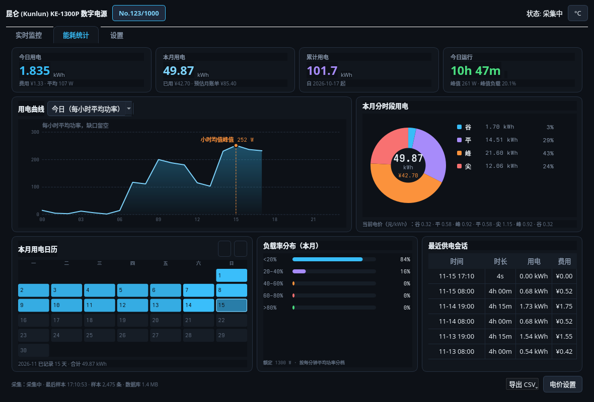
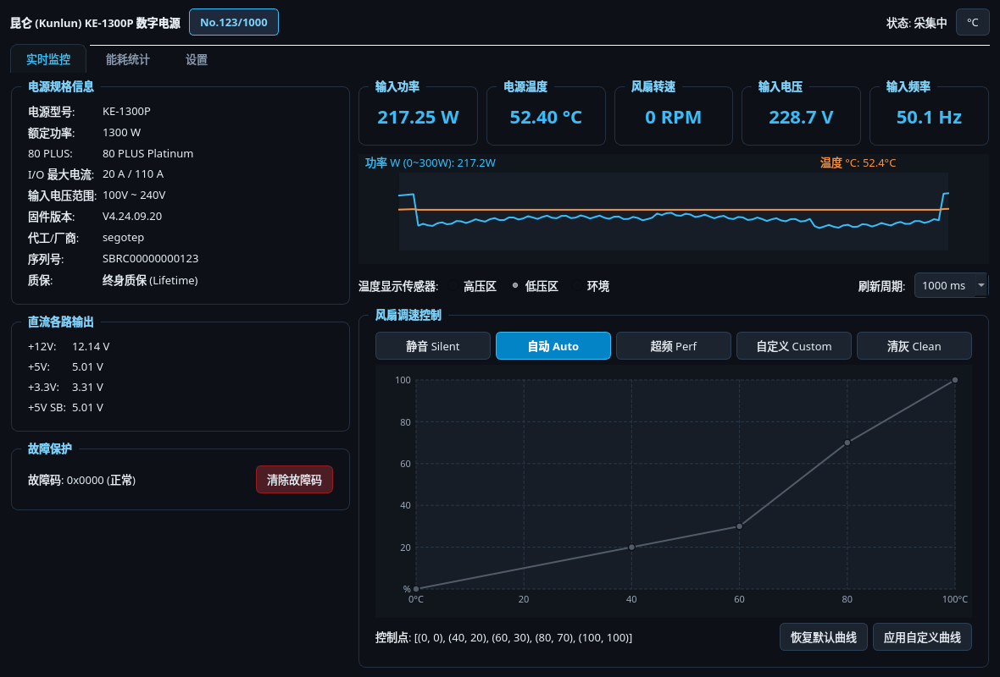

# himos-psu — 鑫谷 / 昆仑 HiMOS 数字电源 Linux 上位机

[](https://github.com/Betlund/himos_psu/actions/workflows/ci.yml)


**在 Linux 上监控并调速鑫谷 / 昆仑（Segotep / Kunlun）HiMOS 系列数字电源。**
厂商只提供 Windows 上位机，这个项目把协议重写了一遍：实时电压/功率/温度、风扇曲线、以及本地的用电量与电费统计，全程离线、无遥测。



## 快速上手

```bash
git clone https://github.com/Betlund/himos_psu.git && cd himos_psu
./bin/himos-psu list          # 自动发现 CH340 (1A86:7523) 电源
./bin/himos-psu-gui           # 桌面面板；无硬件时加 --mock
```

只要 Python ≥ 3.10，Linux 下串口走标准库 `termios`，**不需要装 pyserial**；GUI 需要 `PySide6`。

## 截图

| 实时监控 | 能耗统计 |
|---|---|
|  |  |

> 截图使用 `--mock` 的合成设备与示例数据，序列号与编号均非真实值。

## 特性

- **零额外串口依赖**：Linux 下通过标准库 `termios` / `select` + `/sys/class/tty` 自动发现 `1A86:7523` 串口（跨平台亦可选用 `pyserial`）。
- **协议 1:1 精准实现并修正实机差异**：
  - 自动顺序下发 `POWER_INFO(sub=0)`（型号/规格/代工 `segotep`/SN）与 `POWER_INFO(sub=53)`（固件日期）并合并。
  - 同时兼容 PC 发送端 `crc8(commandContent)` 与实机固件接收端 `crc8(header + commandContent)` 双口径校验。
  - 完整解析 `+3.3V / +5V / +12V / +5VSB`、`输入功率 / 输入电压 / 频率`、高压区 / 低压区 / 环境三路温度、风扇转速与故障码。
  - 严格复刻 `ControlChart` 与 `x9` 分段线性重采样生成 27 字节自定义温控风扇曲线。
- **CLI + PySide6 原生桌面 GUI**：命令行实时监控、JSON 输出、原始十六进制嗅探；GUI 分「实时监控 / 能耗统计 / 设置」三页，含 5 点可拖拽风扇曲线编辑器。
- **后台采集守护进程**：独占串口的 systemd 用户服务，24/7 写库；GUI 通过 Unix socket IPC 跟随，可边采集边调速。
- **能耗统计**：后台采集并把输入功率积分成 kWh，支持固定电价与峰谷（尖/峰/平/谷）电价、今日/本周/本月/今年报表、月历热力图、负载率分布、供电会话、CSV/JSON 导出与改价重算历史费用。

## 命令行

```bash
# 查看检测到的电源串口
./bin/himos-psu list

# 读取规格、固件版本、出厂日期、序列号与徽章状态
./bin/himos-psu info

# 持续刷新监控遥测数据（Ctrl+C 退出）
./bin/himos-psu watch

# 切换风扇模式 (auto / silent / performance / custom / clean)
./bin/himos-psu fan-mode silent
./bin/himos-psu fan-mode custom --curve 0,0 40,20 60,30 80,70 100,100 --save

# 下发自定义 5 点温控曲线 (温度%,占空比%)，加 --save 可同步保存到本地配置
./bin/himos-psu fan-curve 0,0 40,20 60,30 80,70 100,100 --save

# 检查/从本地配置安全恢复风扇模式与曲线（--dry-run 仅打印不写串口）
./bin/himos-psu apply-saved --dry-run

# 启动 PySide6 桌面控制面板（离线体验可追加 --mock）
./bin/himos-psu-gui
```

## 开机自动恢复自定义风扇曲线

鑫谷 / 昆仑 HiMOS 电源的 MCU **不会掉电保存自定义风扇模式与曲线**（协议本身也没有写入 Flash 的指令，每次电脑冷启动或断电重启后都会复位为出厂 `Auto`）。原厂 Windows 上位机依赖后台开机自启在连接串口时重新下发配置；本工具在 Linux 下提供对应的本地持久化与自动恢复机制：

> ⚠️ **这一节是写操作，不是只读监控。** 自动恢复开关默认开启；启用状态下，程序会在连上电源时主动发送
> `0x16`（刷新周期）、`0x13`（风扇模式）和 `0x1B`（自定义曲线）指令，改变电源的运行时设置。
> 只需只读查看时，请用 `list` / `info` / `status` / `watch` / `energy`，或在「设置」页关闭
> 自动恢复开关。检测到锁存故障码时会跳过下发。

- **本地持久化与重连恢复**：在 GUI 中切换风扇模式（`Auto` / `Silent` / `Performance` / `Custom`；一次性的 `Clean` 除外）、点击「应用自定义曲线」或调整刷新周期后，会自动将配置原子写入 `~/.config/himos-psu/settings.json`。此后每次打开 GUI 并收到电源首帧状态遥测后，会自动恢复上次保存的模式与曲线（可在「设置」页开关）。
- **无 GUI 开机自动恢复（`systemd --user`）**：不常驻打开 GUI 时，可安装一次性用户级服务，开机等待串口就绪后安全下发一次即退出：

```bash
# 1. 先离线检查即将下发的配置与 21 档 PWM 占空比（不碰串口）
./bin/himos-psu apply-saved --dry-run

# 2. 生成并启用 systemd 用户服务（串口若已被 GUI/collect 占用会自动跳过）
mkdir -p ~/.config/systemd/user
./bin/himos-psu systemd-unit > ~/.config/systemd/user/himos-psu-restore.service
systemctl --user daemon-reload
systemctl --user enable himos-psu-restore.service
```

## 能耗统计

### 开始采集

```bash
# 前台采集（Ctrl+C 停止）；GUI 打开时也会自动采集
./bin/himos-psu collect

# 查看今日 / 本月 / 自定义区间
./bin/himos-psu energy today
./bin/himos-psu energy month --json
./bin/himos-psu energy report --from 2026-11-01 --to 2026-11-15
```

GUI 的「能耗统计」页会随采集自动刷新；采集进程与 GUI **互斥**（串口被 `TIOCEXCL` 独占），
同时启动时第二个进程会明确提示，而不会静默失败。

### 后台常驻采集（守护进程）

默认只有 GUI 打开时才采集。想让统计连续（只要电脑开着就记录），把采集跑成用户级守护进程：

```bash
# 1. 先手动试跑，确认能连上电源（Ctrl+C 停止）
./bin/himos-psu daemon

# 2. 一条命令装成 systemd --user 服务并立即启用
./bin/himos-psu systemd-daemon --install --enable --linger

# 3. 确认状态
systemctl --user status himos-psu-collect.service
```

`--install` 会写入 `~/.config/systemd/user/himos-psu-collect.service`（跟随 `XDG_CONFIG_HOME`）
并执行 `daemon-reload`；`--enable` 顺带 `enable --now`，`--linger` 让未登录时也采集。
如果此时还有手工 `himos-psu daemon` 在跑，命令会**拒绝启用**并提示先按 Ctrl+C——串口是独占的，
否则新服务只会反复启动失败。只想看单元内容或预览命令，用不带参数或加 `--dry-run`。

守护进程独占串口并 24/7 写 `energy.db`。**GUI 启动时如果发现守护进程在运行，会自动通过
Unix socket 跟随它**（默认 `$XDG_RUNTIME_DIR/himos-psu/daemon.sock`，可用 `HIMOS_PSU_SOCKET`
覆盖），实时数据与风扇调速照常可用——不需要先关服务，也不会因为串口被占而报错。

- 连接后自动恢复保存的风扇配置，等价于原来的 `himos-psu-restore.service`，后者可以退役
- 超过 `--stale-timeout`（单元里默认 180 秒）收不到遥测会自动退出，由 systemd 重启；
  这是应对休眠唤醒后 USB 重新枚举的方式
- 想「开机就采、不必登录」，需要 `loginctl enable-linger $USER`（`--install --linger` 会自动做）
- 只想临时采集仍可用 `./bin/himos-psu collect`（与守护进程/GUI 互斥）

从旧的恢复服务迁移（`--install` 检测到旧单元时会打印这段命令）：

```bash
systemctl --user disable --now himos-psu-restore.service
rm ~/.config/systemd/user/himos-psu-restore.service
systemctl --user daemon-reload
```

### 统计口径与边界

- 统计的是**电源输入端功率**，不含显示器、音箱等外设。
- 固件只提供输入功率与输入电压，**不提供输出电流**，因此本工具不计算转换效率、不做能效曲线。
- 采样间隔由 PSU 自身推送决定（默认 1 s，可用 `refresh-rate` 调到 1–3 s）；能量用**梯形积分**按实测时间戳累积，不使用名义周期。
- 断档（相邻样本间隔 > 5 s）只记录为缺口，**不按 0 W 补算**，并计入覆盖率。
- 覆盖率的**分母是「记录时段」**（首个到最后一个分钟桶），不是日历区间：进程没在跑的整分钟
  既不进覆盖也不记为缺口。所以刚装守护进程那天「今日」可能是 85% 之类，报告里会打印
  `记录时段 09:29–11:29` 便于对照；装配满一天后自然接近 100%。
- 「运行时长」指功率高于 20 W 的时长，与单纯的采集覆盖时长区分。

### 电价方案

内置「示例：居民峰谷」方案（尖/峰/平/谷四段），**价格为示例值，请按当地实际电价修改**：

```bash
# 查看当前方案
./bin/himos-psu tariff list

# 固定电价
./bin/himos-psu tariff set --name 家用电 --price 0.55 --recalc

# 自定义峰谷（时段必须从 00:00 连续覆盖到 24:00）
./bin/himos-psu tariff set --name 峰谷 --bands "0-7:谷:0.32,7-10:平:0.58,10-24:峰:0.92" --recalc

# 按当前方案重算全部历史费用
./bin/himos-psu tariff recalc
```

改价不需要重建数据库：分钟桶保留瓦秒，费用由当前方案重新计算。

### 数据与保留

- 数据库：`~/.local/share/himos-psu/energy.db`（可用 `--db` 或 `HIMOS_PSU_DB` 覆盖），SQLite WAL。
- 原始样本保留 14 天，分钟桶与日/月汇总永久保留，长时间运行体积可控（1 s 采样约 2.5 MB/天）。
- 导出：

```bash
./bin/himos-psu energy export --kind minute --out -        # 分钟明细
./bin/himos-psu energy export --kind daily  --out daily.csv
./bin/himos-psu energy export --kind sessions --out -       # 供电会话
```

## 权限说明

若普通用户无权打开 `/dev/ttyUSB*`，可将用户加入串口所属用户组（如 `uucp` 或 `dialout`），或通过 `./bin/himos-psu udev-rule` 生成标准 `1a86:7523` udev 规则。

## 兼容性

在 `昆仑九重 KE-1300P`（CH340，固件 `V4.24.09.20`）上逆向并实测通过。
其他使用 HiMOS 上位机、同样是 CH340 转串口的型号理论上通用，但未逐款验证——如果你测试成功，欢迎开 issue 报告型号。

## 开发与测试

```bash
# 单元测试（协议、能耗积分、电价、GUI 离屏渲染）
/usr/bin/python3 -m unittest discover -s tests

# 完整本地流水线：语法 + 测试 + 隐私扫描（工作区/暂存区/全历史）
./tools/pipeline.sh

# 无硬件联调：先用 mock 电源采集一段，再查看报表
./bin/himos-psu --mock collect --db /tmp/demo.db
./bin/himos-psu energy --db /tmp/demo.db today
```

测试覆盖真实抓包帧解码、CRC 双口径、分包重同步、梯形积分与断档、峰谷边界、改价重算、CSV 导出、采集锁互斥，以及 GUI 三个页签的离屏渲染。

## 更新日志

见 [CHANGELOG.md](CHANGELOG.md)，当前版本 [v0.2.0](https://github.com/Betlund/himos_psu/releases/tag/v0.2.0)。

## 开源协议

[MIT](LICENSE) © 2026 BetLund

本项目是对厂商私有软件行为的独立实现，与鑫谷 / 昆仑（Segotep / Kunlun）及其关联公司无关，
未获其授权或背书。产品名称与型号仅用于说明兼容性。使用本工具可能使电源运行在非出厂设定的
风扇曲线上，请自行评估风险；因使用本软件造成的任何损失，作者不承担责任。

---

如果这个项目帮你省下了折腾的时间，点个 ⭐ 是最大的鼓励；有问题或新机型适配欢迎开 issue。
